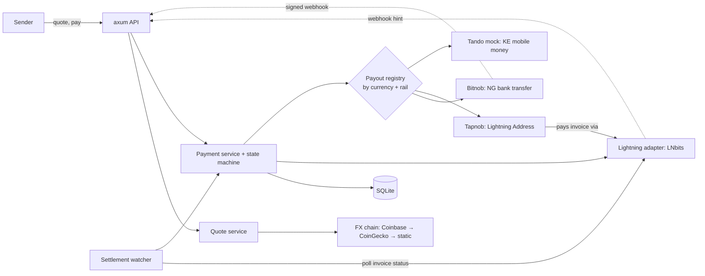

# SatsBridge — Implementation Status

**As of:** 2026-10-21
**Scope:** Backend only (`backend/`). The frontend has not been started.
**Build:** compiles with no warnings, clippy clean, 44 automated tests passing (`cargo test`), plus 2 opt-in live tests.
**Related docs:** PRD v1.0 · [NGN payout addendum](prd-addendum-ngn-payout.md) · [backend README](../backend/README.md) (setup, API, demo script)

---

## 1. Summary

The backend implements the full PRD payment lifecycle: quote → payment intent → Lightning invoice → settlement → local payout → completed, with a timestamped audit trail. Every external system sits behind an adapter interface. Lightning is always real (LNbits). Payout providers also have mocks for demos. The integrations:

| Integration | Status | Used for |
|---|---|---|
| Coinbase exchange rates | **Live**, verified against the real API | BTC price per currency (primary) |
| CoinGecko simple price | **Live**, verified against the real API | BTC price per currency (fallback) |
| LNbits | **Verified against a real LNbits server** (v1.x, test funding source): invoices, settlement by watcher and by webhook, outgoing payment, idempotent retry. Not yet run with real funds | Receiving sender payments; paying Lightning Addresses |
| Bitnob payouts | **Built** from Bitnob's OpenAPI spec, tested against a fake server. Client ID received; needs the client secret to run the live check | NGN bank transfers |
| Tapnob (Lightning Address) | **Built**; address lookup verified against real `tapnob.io` | NGN via the recipient's Tapnob account |
| Tando | **Mock only** | KES / M-Pesa |

## 2. Architecture



- **Stack:** Rust 2024 edition, axum 0.8, tokio, sqlx with SQLite (migrations run at startup), reqwest with rustls.
- **Layout:** `api/` HTTP handlers · `services/` business logic · `adapters/` external systems · `domain/` currencies, money, state machine · `db.rs` models and queries.

## 3. PRD functional requirements

| ID | Requirement | Status | Notes |
|---|---|---|---|
| FR-01 | Currency selection | ✅ | `GET /currencies` lists XOF, XAF, GNF, KES, NGN with each one's decimal places and available payout rails |
| FR-02 | Amount entry (source or destination) | ✅ | `amount_side: source \| destination` |
| FR-03 | Quote engine | ✅ | Rate, fee (in sats and in the sender's currency), recipient amount, expiry; `rate_source` and `rate_as_of` recorded |
| FR-04 | Payment creation | ✅ | One payment per quote, enforced by a database constraint |
| FR-05 | Lightning settlement | ✅ | LNbits invoices; settlement only when LNbits reports the invoice paid (watcher or webhook). Verified on a real LNbits server |
| FR-06 | LNURL | 🟡 Partial | We **pay** LNURL-pay / Lightning Addresses (Tapnob). We don't yet **serve** LNURL-pay to senders |
| FR-07 | Payout after settlement | ✅ | Exactly one payout request per payment |
| FR-08 | Status tracking | ✅ | `GET /payments/{id}` returns status, invoice, payout and audit events |
| FR-09 | Transaction history | ✅ | `GET /transactions`; not yet scoped per user |
| FR-10 | Failure handling | ✅ | Expired quotes and invoices, failed or expired payouts, provider errors, reversals |
| FR-11 | Receipts | ✅ | Payment details plus payout plus masked recipient plus audit trail |
| FR-12 | Provider abstraction | ✅ | `FxProvider`, `LightningAdapter`, `PayoutAdapter` traits; payout registry keyed by currency and rail |

### NGN addendum

| ID | Status | Notes |
|---|---|---|
| FR-NGN-01 NGN destination | ✅ | Rails: `NG_BANK_TRANSFER` (Bitnob or mock) and `LIGHTNING_ADDRESS` (Tapnob) |
| FR-NGN-02 Bank list | ✅ | `GET /payout-institutions?currency=NGN`; Bitnob supplies its NIP list |
| FR-NGN-03 Account resolution | ✅ | `POST /recipients/resolve` → `resolution_id`, which is required to create a bank payment |
| FR-NGN-04 Recipient validation | ✅ | 10-digit account number, known bank, resolution must match the bank and account (stored hashed) |
| FR-NGN-05 Kobo precision | ✅ | All amounts are integer minor units |
| FR-NGN-06 NGN quote | ✅ | Live rates; the Tapnob rail is flagged `payout_amount_guaranteed: false` |
| FR-NGN-07 Single payout | ✅ | Payment ID is the provider reference and idempotency key |
| FR-NGN-08 Reversals | ✅ | `COMPLETED → FAILED → REFUND_PENDING`. Note that Bitnob's webhooks have no reversal event |
| FR-NGN-09 Limits | ✅ | Configurable maximum; Bitnob minimum of ₦500 |
| FR-NGN-10 Receipt fields | ✅ | Masked account, resolved name, provider reference |

## 4. Payment lifecycle

```
CREATED → QUOTED → AWAITING_PAYMENT → SETTLED → PAYOUT_PENDING → COMPLETED
                         ↓                            ↓              ↓ (reversal)
                      EXPIRED                       FAILED  ←────────┘
                                                      ↓
                                               REFUND_PENDING → REFUNDED
```

- Each status change only happens if the payment is still in the expected status (compare-and-set), and each one writes an `audit_events` row.
- **Exactly one payout per payment** is guaranteed three ways: repeated webhook events are discarded, status changes are compare-and-set, and the database allows only one payout row per payment.
- **Lightning Address payouts** finish immediately: a successful Lightning payment moves the payment straight to `COMPLETED`.
- **Bitnob payouts** finish when the `payouts.withdrawal.success` webhook arrives.
- **Uncertain outgoing payments** (timeouts, payments still in flight) stay `PAYOUT_PENDING`. They are never marked failed or refundable.

## 5. Provider details

### FX: Coinbase and CoinGecko
- **Coinbase** `GET /v2/exchange-rates?currency=BTC` needs no key and covers all five currencies.
- **CoinGecko** covers EUR, NGN and KES, but has **no GNF**.
- **XOF and XAF** are always calculated as BTC/EUR × 655.957, the fixed euro peg, whichever source is used.
- **Caching:** prices are fetched at most every 30 s. If a source goes down, its last good prices are used for up to 5 minutes, and after that quotes fail.
- These are reference rates, not prices you can trade at. For Bitnob payouts, Bitnob's own rate applies to the Naira leg, and we absorb any difference, which is logged.

### LNbits (Lightning)
- **Keys:** the invoice key creates invoices and reads their status. The admin key pays invoices and is only needed for Tapnob payouts.
- **Startup check:** each key is checked with `GET /api/v1/wallet`, and SatsBridge won't start if one fails.
- **Webhooks:** LNbits's invoice webhook is **unsigned**, and it posts the payment as a JSON-encoded string. So settlement is always confirmed with `GET /api/v1/payments/{hash}`, and a background watcher polls unpaid invoices (`LIGHTNING_POLL_SECS`, default 5 s).
- **Webhook URL rules:** LNbits only accepts callback URLs on domain names by default. If it rejects `LNBITS_WEBHOOK_URL`, the invoice is created without it.
- **No fake settlement:** there is no shared-secret Lightning webhook and no dev settle route.
- **Invoice parsing:** invoices LNbits issues may lack the BOLT11 feature field. We verify signature, hash, amount, description hash and expiry ourselves instead of using `lightning-invoice`'s strict check, which rejects them.
- **Retries:** retrying payment of an already-paid invoice returns the existing payment and moves no money (verified live).
- **Fees:** LNbits has no per-payment fee cap; its own fee reserve applies.

### Bitnob (NGN bank transfer)
- **Host:** `https://api.bitnob.com` for both sandbox and production. The client secret you sign with selects the environment.
- **Auth:** HMAC-SHA256 over `client_id:timestamp:nonce:body`, sent in the `x-auth-*` headers.
- **Flow:** account lookup → quote (`settlement_amount` in NGN) → initialize (beneficiary) → **finalize (irreversible)**.
- **Funding:** payouts are debited from the workspace's **Bitnob balance** (`source: offchain`). See §7.
- **Webhooks:** `x-bitnob-signature` is HMAC-SHA512 of the raw body. `withdrawal.success` → `COMPLETED`, `withdrawal.expired` → `FAILED`.

### Tapnob (Lightning Address)
- **Recipient:** gives `name@tapnob.io`. Tapnob converts received sats to Naira and pays the recipient's linked bank account.
- **Integration:** standard LNURL-pay. We validate the invoice amount and its metadata hash, then pay it from LNbits.
- **Safety:** only allowlisted domains are contacted (`TAPNOB_DOMAINS`), and redirects aren't followed.
- **Trade-offs:** Tapnob sets the Naira rate, so the quoted amount is an estimate. There's no account-name check and no confirmation of the bank credit.

## 6. Security

- **Webhooks:** each webhook is checked with its own method. The generic provider webhook uses HMAC-SHA256. Bitnob's uses HMAC-SHA512. LNbits webhooks are confirmed by asking LNbits for the payment status.
- **Settlement:** nothing can mark a payment paid except LNbits itself. The dev simulator only works for mock payout providers.
- **Replays:** webhook replays are blocked by de-duplicating on `(source, event_id)`.
- **API key:** an optional bearer API key protects the non-public endpoints, and it is compared in constant time.
- **Personal data:** full recipient details are never returned by the API. Account numbers are masked in responses and stored hashed for resolution checks.
- **Server-side amounts:** all amounts are computed on the server. Client-supplied amounts and names aren't trusted.
- **Secrets:** read from environment variables only. `.env` is git-ignored, and `Config` deliberately has no `Debug` implementation.

## 7. Why a funded Bitnob account is needed

Bitnob's documented payout API only debits the caller's own Bitnob balance (`source: offchain`):

1. **Bitnob sends the Naira, so it must know who it is sending for.** Bitnob is the party making the NIP transfer and carries the compliance obligations for it. So it issues API keys to a verified business workspace. Check with Bitnob how much verification sandbox keys need.
2. **The funds must be there before the transfer.** NIP transfers are instant and final. Bitnob won't extend credit, so the value has to be in your balance before finalize.
3. **Per-payment funding over Lightning isn't documented.** Bitnob's spec has no way to fund a single payout from an incoming Lightning payment, which is what SatsBridge would ideally do. Ask Bitnob whether a Lightning `source` exists for payouts.

**Operating model this implies (treasury):** senders pay SatsBridge's LNbits wallet. Bitnob pays recipients from a float you hold with Bitnob. You top that float up periodically, for example by paying sats from LNbits to your Bitnob BTC deposit address or invoice. The float is SatsBridge's own BTC exposure and liquidity risk, so size it to expected daily volume.

**No-account alternative:** the Tapnob rail. There the *recipient* holds the account, and SatsBridge only needs outbound Lightning liquidity in LNbits.

## 8. Configuration

All settings are in `backend/.env.example`. The main switches:

| Variable | Values | Default |
|---|---|---|
| `FX_PROVIDERS` | `coinbase,coingecko[,static]` | `coinbase,coingecko` |
| `LNBITS_URL`, `LNBITS_INVOICE_KEY` | LNbits instance and receive key | **required** |
| `NGN_BANK_PROVIDER` | `mock` \| `bitnob` | `mock` |
| `TAPNOB_DOMAINS` | comma list; empty disables | `tapnob.io` |
| `DEV_ROUTES` | simulation endpoints for demos | `false` |

## 9. Tests (44 + 2 live)

- **Domain:** state-machine transitions, money rounding, recipient parsing and masking.
- **Quotes:** source and destination math, fee floor, limits, expiry.
- **FX:** Coinbase and CoinGecko parsing, euro-peg derivation, caching, serving last good prices, rejecting stale prices, per-currency fallback.
- **LNbits** (fake server):
  - invoice creation and status
  - immediate, pending-then-paid, and failed payments
  - missing admin key
  - webhook-URL rejection fallback
  - double-encoded webhook bodies
- **BOLT11 decoding:** a real LNbits invoice without feature bits, garbage and tampered invoices.
- **Bitnob** (fake server that checks signatures): whoami, account lookup, quote → initialize → finalize, rejection of bad credentials, webhook mapping.
- **Tapnob** (fake LNURL server): lookup and payment, unknown user, foreign domain, invoice amount and metadata checks, subdomain allowlist.
- **End to end** (through the router):
  - XOF → NGN with exactly one payout under replayed webhooks
  - reversal
  - KES via dev routes
  - Tapnob rail completing on payment
  - Bitnob webhook verification
  - watcher settlement and deduplication
  - invoice expiry
  - webhooks for unpaid invoices are ignored
  - there are no fake-settlement endpoints
  - the dev simulator refuses real providers
  - bad signatures and bad recipients
- **Live, opt-in:** `bitnob_live` (read-only whoami and bank list) and `lnbits_live` (receive and send 21 sats, idempotent retry).

**Verified against live services:**
- Coinbase and CoinGecko.
- Tapnob address lookup.
- LNbits (a real server run locally with its test funding source): startup key checks, invoice → payment → watcher settlement → payout, settlement by the real LNbits webhook, the webhook-URL rejection fallback, and outgoing payment with idempotent retry.

**Not yet verified live:** Bitnob (needs the client secret), and LNbits with real funds.

## 10. Known gaps and next steps

**Before a live demo**
1. Create an LNbits wallet on a real Lightning backend, and set `LNBITS_URL` and `LNBITS_INVOICE_KEY`.
2. Add the Bitnob client secret to `.env` and run `cargo test --test bitnob_live`. Then fund the sandbox balance and check one webhook signature. The adapter assumes the signature is hex.
3. Expose the server publicly (or tunnel it) so Bitnob can reach `BITNOB_CALLBACK_URL`.

**Correctness and robustness**
- **Payout retries:** add an outbox/retry worker for payout submission. Until then, a payout interrupted mid-way stays `PAYOUT_PENDING`, and Bitnob's behaviour on a reused `reference` is unknown, so it needs reconciliation before any retry.
- **Bitnob rates:** use Bitnob's rate for the Naira leg at quote time.
- **Refunds:** carry out refunds (`REFUND_PENDING → REFUNDED`).

**Product**
- Serve LNURL-pay to senders (finishes FR-06).
- Per-user authentication, scoped transaction history, rate limiting.
- **More corridors through Bitnob:** its limits list KES, XOF (CI/SN/NE) and XAF (CM), which could replace the Tando mock and cover the remaining corridors.
- Frontend.

**Security hardening**
- Use a keyed hash (with a dedicated secret) for stored account-number hashes.
- Add an explicit CORS allowlist once the frontend exists.

**Compliance:** demo and sandbox only. Production needs a licensed payout partner relationship, KYC/AML, and legal review (PRD §14).
