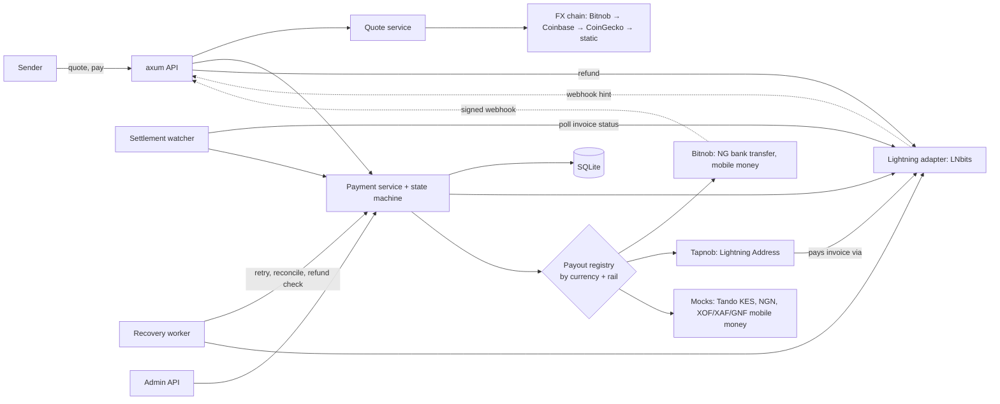

# SatsBridge — Implementation Status

**As of:** 2026-10-28
**Scope:** Backend (`backend/`). The API has been run end to end with the local stand-ins (payment, payout, failure and refund).
**Build:** compiles with no warnings, clippy clean, 71 automated tests passing (`cargo test`: 44 unit, 27 end-to-end), plus 2 opt-in live tests that skip without credentials.
**Related docs:** PRD v1.0 · [NGN payout addendum](prd-addendum-ngn-payout.md) · [backend README](../backend/README.md) (setup, API, demo script)

---

## 1. Summary

The backend implements the full PRD payment lifecycle: quote → payment intent → Lightning invoice → settlement → local payout → completed, with a timestamped audit trail. Around it sit per-user accounts, refunds, a payout recovery worker, LNURL-pay for senders, an admin API and rate limiting. Every external system sits behind an adapter interface. Lightning is always real (LNbits). Payout rails that no real provider serves are mocks, for demos.

| Integration | Status | Used for |
|---|---|---|
| Coinbase exchange rates | **Live**, verified against the real API | BTC price per currency |
| CoinGecko simple price | **Live**, verified against the real API | BTC price per currency (fallback) |
| LNbits | Also available as a local stand-in (`lnbits_sandbox`) for running without a node. **Verified against a real LNbits server** (v1.x, test funding source): invoices, settlement by watcher and by webhook, outgoing payment, idempotent retry. Not yet run with real funds | Receiving sender payments; paying Lightning Addresses; refunds |
| Bitnob | **Built** from Bitnob's OpenAPI spec and tested against a fake server and the local `bitnob_sandbox` stand-in. **Never run against the real API**: needs the client secret | NGN bank transfers, mobile money (KE, XOF, XAF countries), payout rate for quotes |
| Tapnob (Lightning Address) | **Built**; address lookup verified against real `tapnob.io` | NGN via the recipient's Tapnob account |
| Tando | **Mock only** | KES / M-Pesa (Bitnob `KE` could replace it) |

## 2. Architecture



- **Stack:** Rust 2024 edition, axum 0.8, tokio, sqlx with SQLite (migrations run at startup), reqwest with rustls.
- **Layout:** `api/` HTTP handlers · `services/` business logic · `adapters/` external systems · `domain/` currencies, money, state machine · `db.rs` models and queries · `bin/bitnob_sandbox.rs` local Bitnob stand-in.
- **Background tasks:** the settlement watcher (`LIGHTNING_POLL_SECS`) and the recovery worker (`RECOVERY_POLL_SECS`).

## 3. PRD functional requirements

| ID | Requirement | Status | Notes |
|---|---|---|---|
| FR-01 | Currency selection | ✅ | `GET /currencies` lists XOF, XAF, GNF, KES, NGN with each one's decimal places and available payout rails |
| FR-02 | Amount entry (source or destination) | ✅ | `amount_side: source \| destination` |
| FR-03 | Quote engine | ✅ | Rate, fee (in sats and in the sender's currency), recipient amount, expiry; `rate_source` and `rate_as_of` recorded. Any currency, including NGN, can be the source |
| FR-04 | Payment creation | ✅ | One payment per quote, enforced by a database constraint |
| FR-05 | Lightning settlement | ✅ | LNbits invoices; settlement only when LNbits reports the invoice paid (watcher or webhook). Verified on a real LNbits server |
| FR-06 | LNURL | ✅ | We **serve** LNURL-pay to senders (`/lnurlp/{id}`, needs `PUBLIC_BASE_URL`) and **pay** Lightning Addresses (Tapnob). A wallet scanning the LNURL gets the payment's one invoice |
| FR-07 | Payout after settlement | ✅ | Exactly one payout request per payment |
| FR-08 | Status tracking | ✅ | `GET /payments/{id}` returns status, invoice, LNURL, payout and audit events |
| FR-09 | Transaction history | ✅ | `GET /transactions`, scoped to the authenticated user |
| FR-10 | Failure handling | ✅ | Expired quotes and invoices, failed or expired payouts, provider errors, reversals, payout retry and reconciliation, Lightning refunds |
| FR-11 | Receipts | ✅ | Payment details plus payout plus masked recipient plus audit trail |
| FR-12 | Provider abstraction | ✅ | `FxProvider`, `LightningAdapter`, `PayoutAdapter` traits; payout registry keyed by currency and rail |

### NGN addendum

| ID | Status | Notes |
|---|---|---|
| FR-NGN-01 NGN destination | ✅ | Rails: `NG_BANK_TRANSFER` (Bitnob or mock) and `LIGHTNING_ADDRESS` (Tapnob) |
| FR-NGN-02 Bank list | ✅ | `GET /payout-institutions?currency=NGN`; Bitnob supplies its NIP list |
| FR-NGN-03 Account resolution | ✅ | `POST /recipients/resolve` → `resolution_id`, which is required to create a bank payment |
| FR-NGN-04 Recipient validation | ✅ | 10-digit account number, known bank, resolution must match the bank and account (stored hashed) |
| FR-NGN-05 Kobo precision | ✅ | All amounts are integer minor units |
| FR-NGN-06 NGN quote | ✅ | Live rates (Bitnob's own when enabled); the Tapnob rail is flagged `payout_amount_guaranteed: false` |
| FR-NGN-07 Single payout | ✅ | Payment ID is the provider reference and idempotency key; retries use `{payment_id}-r{n}` |
| FR-NGN-08 Reversals | ✅ | `COMPLETED → FAILED → REFUND_PENDING`. Note that Bitnob's webhooks have no reversal event |
| FR-NGN-09 Limits | 🟡 | Per-payout limits only (Bitnob's per country, `NGN_MAX_PAYOUT_MINOR` on the mock). **No daily limit** |
| FR-NGN-10 Receipt fields | ✅ | Masked account, resolved name, provider reference |

### Beyond the PRD

| Capability | Status | Notes |
|---|---|---|
| Per-user accounts | ✅ | `POST /users` issues an anonymous bearer token, shown once and stored hashed. Quotes, payments and transactions are private to their user. No token recovery |
| Refunds | ✅ | A failed or reversed payout goes to `REFUND_PENDING`. The sender (or an admin) supplies a BOLT11 invoice for exactly the sats paid, and LNbits pays it. Never paid twice |
| Payout recovery | ✅ | Worker resubmits unsubmitted payouts (after asking the provider whether an earlier attempt paid), asks about payouts with no webhook, and resolves refunds with unknown outcome. Rails that can't be checked go to manual review |
| Admin API | ✅ | `ADMIN_API_KEY`: summary metrics (completion rate, timings, corridors), payment list with `needs_review` filter, retry, fail-payout, refund, run-recovery |
| Rate limiting | ✅ | Per user, per IP on public routes, and per IP on sign-ups; in memory, so per instance |
| Mobile money corridors | ✅ built, 🟡 unverified | Bitnob `MOBILE_MONEY` for KE, SN, CI, NE, CM and others; field names are read from Bitnob at startup. Mock for XOF, XAF and GNF |
| CORS allowlist | ✅ | `CORS_ALLOWED_ORIGINS`; with none set, only `DEV_ROUTES` allows browsers |

## 4. Payment lifecycle

```
CREATED → QUOTED → AWAITING_PAYMENT → SETTLED → PAYOUT_PENDING → COMPLETED
                         ↓                            ↓              ↓ (reversal)
                      EXPIRED                       FAILED  ←────────┘
                                                      ↓
                                               REFUND_PENDING → REFUNDED
```

- Each status change only happens if the payment is still in the expected status (compare-and-set), and each one writes an `audit_events` row.
- **Exactly one payout per payment** is guaranteed four ways: repeated webhook events are discarded, status changes are compare-and-set, the database allows only one payout row per payment, and each submission attempt is claimed atomically before any provider call.
- **Lightning Address payouts** finish immediately: a successful Lightning payment moves the payment straight to `COMPLETED`.
- **Bitnob payouts** finish when the `payouts.withdrawal.success` webhook arrives, or when the recovery worker finds the status at Bitnob.
- **A failed payout** (provider failure, or an admin marking it failed) automatically continues `FAILED → REFUND_PENDING`; `REFUNDED` follows once the refund is paid.
- **Uncertain outgoing payments** (timeouts, payments still in flight) are never marked failed or refundable. The recovery worker checks the outcome.

## 5. Provider details

### FX: Bitnob, Coinbase and CoinGecko
- **Bitnob** (when `BITNOB_COUNTRIES` is set) derives the BTC price from a throwaway payout quote, so quotes use the rate Bitnob actually pays out at. It is first in the chain by default, refreshed at most every 60 s.
- **Coinbase** `GET /v2/exchange-rates?currency=BTC` needs no key and covers all five currencies.
- **CoinGecko** covers EUR, NGN and KES, but has **no GNF**.
- **XOF and XAF** from Coinbase and CoinGecko are always calculated as BTC/EUR × 655.957, the fixed euro peg.
- **Caching:** prices are fetched at most every 30 s. If a source goes down, its last good prices are used for up to 5 minutes, and after that quotes fail.
- Coinbase and CoinGecko prices are reference rates, not prices you can trade at. When Bitnob pays out and its rate differs from the quote, SatsBridge absorbs the difference and logs it.

### LNbits (Lightning)
- **Keys:** the invoice key creates invoices and reads their status. The admin key pays invoices and is needed for Tapnob payouts and refunds.
- **Startup check:** each key is checked with `GET /api/v1/wallet`, and SatsBridge won't start if one fails.
- **Webhooks:** LNbits's invoice webhook is **unsigned**, and it posts the payment as a JSON-encoded string. So settlement is always confirmed with `GET /api/v1/payments/{hash}`, and a background watcher polls unpaid invoices (`LIGHTNING_POLL_SECS`, default 5 s).
- **Webhook URL rules:** LNbits only accepts callback URLs on domain names by default. If it rejects `LNBITS_WEBHOOK_URL`, the invoice is created without it.
- **No fake settlement:** there is no shared-secret Lightning webhook and no dev settle route.
- **Invoice parsing:** invoices LNbits issues may lack the BOLT11 feature field. We verify signature, hash, amount, description hash and expiry ourselves instead of using `lightning-invoice`'s strict check, which rejects them.
- **Retries:** retrying payment of an already-paid invoice returns the existing payment and moves no money (verified live).
- **Fees:** LNbits has no per-payment fee cap; its own fee reserve applies. Refunds cap the fee at 0.5% (minimum 10 sats).

### Bitnob (bank transfer and mobile money)
- **Host:** `https://api.bitnob.com` for both sandbox and production. The client secret you sign with selects the environment. `BITNOB_BASE_URL` overrides the host, which is how the local stand-in is used.
- **Auth:** HMAC-SHA256 over `client_id:timestamp:nonce:body`, sent in the `x-auth-*` headers.
- **Startup:** `whoami` (logs sandbox vs production), payout limits, and each country's beneficiary field rules. Any failure stops the API from starting. `BITNOB_CLIENT_ID`, `BITNOB_CLIENT_SECRET` and `BITNOB_WEBHOOK_SECRET` are all required when `BITNOB_COUNTRIES` is set.
- **Flow:** account lookup (NGN only) → quote (`settlement_amount` in the destination currency) → initialize (beneficiary) → **finalize (irreversible)**.
- **Funding:** payouts are debited from the workspace's **Bitnob balance** (`source: offchain`). See §7.
- **Webhooks:** `x-bitnob-signature` is HMAC-SHA512 of the raw body. `withdrawal.success` → `COMPLETED`, `withdrawal.expired` → `FAILED`.
- **Local stand-in:** `cargo run --bin bitnob_sandbox` implements the endpoints above with signature checks, a pretend balance and signed webhooks, for working without credentials. See the [backend README](../backend/README.md#bitnob-local-sandbox). It proves our side only.

### Tapnob (Lightning Address)
- **Recipient:** gives `name@tapnob.io`. Tapnob converts received sats to Naira and pays the recipient's linked bank account.
- **Integration:** standard LNURL-pay. We validate the invoice amount and its metadata hash, then pay it from LNbits.
- **Safety:** only allowlisted domains are contacted (`TAPNOB_DOMAINS`), and redirects aren't followed.
- **Trade-offs:** Tapnob sets the Naira rate, so the quoted amount is an estimate. There's no account-name check and no confirmation of the bank credit.

## 6. Security

- **Authentication:** user routes need a bearer token; only its SHA-256 is stored. Another user's payment or quote returns 404. Admin routes need `ADMIN_API_KEY` (compared in constant time) and are not mounted at all without it.
- **Webhooks:** each webhook is checked with its own method. The generic provider webhook uses HMAC-SHA256. Bitnob's uses HMAC-SHA512. LNbits webhooks are confirmed by asking LNbits for the payment status.
- **Settlement:** nothing can mark a payment paid except LNbits itself. The dev simulator only works for mock payout providers.
- **Replays:** webhook replays are blocked by de-duplicating on `(source, event_id)`.
- **Rate limits:** per user, per IP, and per IP for sign-ups.
- **CORS:** explicit allowlist (`CORS_ALLOWED_ORIGINS`). LNURL routes allow any origin, as wallets require.
- **Personal data:** full recipient details are never returned by the API. Account numbers are masked in responses and stored hashed for resolution checks.
- **Server-side amounts:** all amounts are computed on the server. Client-supplied amounts and names aren't trusted.
- **Secrets:** read from environment variables only. `.env` is git-ignored, and `Config` deliberately has no `Debug` implementation.

## 7. Why a funded Bitnob account is needed

Bitnob's documented payout API only debits the caller's own Bitnob balance (`source: offchain`):

1. **Bitnob sends the Naira, so it must know who it is sending for.** Bitnob is the party making the NIP transfer and carries the compliance obligations for it. So it issues API keys to a verified business workspace. Check with Bitnob how much verification sandbox keys need.
2. **The funds must be there before the transfer.** NIP transfers are instant and final. Bitnob won't extend credit, so the value has to be in your balance before finalize.
3. **Per-payment funding over Lightning isn't documented.** Bitnob's spec has no way to fund a single payout from an incoming Lightning payment, which is what SatsBridge would ideally do. Ask Bitnob whether a Lightning `source` exists for payouts.

**Operating model this implies (treasury):** senders pay SatsBridge's LNbits wallet. Bitnob pays recipients from a float you hold with Bitnob. You top that float up periodically, for example by paying sats from LNbits to your Bitnob BTC deposit address or invoice. The float is SatsBridge's own BTC exposure and liquidity risk, so size it to expected daily volume.

**No-account alternative:** the Tapnob rail. There the *recipient* holds the account, and SatsBridge only needs outbound Lightning liquidity in LNbits.

## 8. Configuration

All settings are in `backend/.env.example` and the [backend README](../backend/README.md#configuration). The main switches:

| Variable | Values | Default |
|---|---|---|
| `LNBITS_URL`, `LNBITS_INVOICE_KEY` | LNbits instance and receive key | **required** |
| `PUBLIC_BASE_URL` | public https origin; enables LNURL and default webhook URLs | — |
| `BITNOB_COUNTRIES` | e.g. `NG,KE,SN`; empty disables Bitnob | — |
| `BITNOB_BASE_URL` | Bitnob host, e.g. the local stand-in | `https://api.bitnob.com` |
| `MOCK_PAYOUTS` | mock rails where no real provider serves a currency and rail | `true` |
| `FX_PROVIDERS` | `bitnob,coinbase,coingecko[,static]` | `bitnob,coinbase,coingecko` with Bitnob, else `coinbase,coingecko` |
| `TAPNOB_DOMAINS` | comma list; empty disables | `tapnob.io` |
| `ADMIN_API_KEY` | enables `/admin/*` | — |
| `CORS_ALLOWED_ORIGINS` | frontend origins | none (`.env.example`: `http://localhost:3000`) |
| `DEV_ROUTES` | simulation endpoints for demos | `false` |

## 9. Tests (71 + 2 live)

- **Unit (44):**
  - Domain: state-machine transitions, money rounding, recipient parsing and masking.
  - Quotes: source and destination math, fee floor, limits, expiry.
  - FX: Coinbase and CoinGecko parsing, euro-peg derivation, caching, serving last good prices, rejecting stale prices, per-currency fallback, Bitnob rate probes.
  - LNbits (fake server): invoice creation and status, immediate, pending-then-paid and failed payments, missing admin key, webhook-URL rejection fallback, double-encoded webhook bodies.
  - BOLT11 decoding: a real LNbits invoice without feature bits, garbage and tampered invoices.
  - Bitnob (fake server that checks signatures): whoami, limits and field rules per country, account lookup, quote → initialize → finalize, mobile money field mapping, reconciliation by reference, rejection of bad credentials, webhook mapping.
  - Tapnob (fake LNURL server): lookup and payment, unknown user, foreign domain, invoice amount and metadata checks, subdomain allowlist.
  - LNURL encoding, recovery back-off.
- **End to end, through the router (`payment_flow`, 9):**
  - XOF → NGN with exactly one payout under replayed webhooks, and reversal
  - KES via dev routes, NGN as the source currency
  - Tapnob rail completing on payment
  - Bitnob webhook verification
  - watcher settlement and deduplication, and invoice expiry
  - expired quotes and limits, bad signatures and bad recipients
- **Platform (`platform`, 14):**
  - payments private to their user; rate limits on users and sign-ups
  - LNURL-pay serves the payment's one invoice and creates it if needed
  - failed payouts refunded to the sender; refunds with unknown outcome resolved by recovery
  - recovery: resubmits after an unconfirmed attempt, reuses an earlier accepted attempt, waits for back-off and gives up after the maximum, sends unsafe rails to review, asks providers about unconfirmed payouts
  - admin: decides on review items, fails a stuck payout into refund, reports summary metrics
  - XOF → XAF over mobile money
- **Bitnob stand-in (`bitnob_sandbox`, 2):** starts the real `bitnob_sandbox` binary and runs the real Bitnob adapter against it: a successful payout, an expired one, signed webhooks verified, reconciliation, a rejected credential and a rejected beneficiary.
- **LNbits stand-in (`lnbits_sandbox`, 2):** starts the real `lnbits_sandbox` binary and runs the real LNbits adapter against it: signed invoices, settlement only once the sandbox reports payment, the double-encoded webhook, the LNURL description hash, expiry, outgoing payments with an idempotent retry, and the invoice/admin key rules.
- **Live, opt-in:** `bitnob_live` (read-only whoami, limits, bank list and field rules; also works against the stand-in) and `lnbits_live` (receive and send 21 sats, idempotent retry). They are `#[ignore]`d, so a plain `cargo test` never calls a real provider or moves sats; run them with `-- --ignored`. They also pass trivially when their credentials aren't set.

**Verified against live services:**
- Coinbase and CoinGecko.
- Tapnob address lookup.
- LNbits (a real server run locally with its test funding source): startup key checks, invoice → payment → watcher settlement → payout, settlement by the real LNbits webhook, the webhook-URL rejection fallback, and outgoing payment with idempotent retry.

**Not yet verified live:** Bitnob (needs the client secret), and LNbits with real funds. Refunds, recovery and LNURL are covered by end-to-end tests with a test Lightning node, not by a live run.

## 10. Known gaps and next steps

**Before a live demo**
1. Create an LNbits wallet on a real Lightning backend, and set `LNBITS_URL` and `LNBITS_INVOICE_KEY`.
2. Add the Bitnob client secret and webhook secret to `.env` and run `cargo test --test bitnob_live -- --ignored --nocapture`. It prints whether the keys are sandbox or production, and each country's limits and fields. Then fund the sandbox balance and check one webhook signature. The adapter assumes the signature is hex. Until credentials exist, use the local stand-in.
3. Expose the server publicly (or tunnel it) so Bitnob can reach `BITNOB_CALLBACK_URL`.

**Correctness and robustness**
- **Daily NGN limits** (FR-NGN-09) are not implemented.
- **Real KES provider:** Tando is a mock. Bitnob `KE` could replace it but is unverified live.
- **Token recovery:** the anonymous user token cannot be recovered if lost.
- **Single instance:** SQLite and in-memory rate limits mean one API instance.

**Security hardening**
- Use a keyed hash (with a dedicated secret) for stored account-number hashes (`security::hash_account`).
- The Lightning Address adapter's note that a real node must refuse to pay the same idempotency key twice. LNbits did behave correctly in the live test.

**Compliance:** demo and sandbox only. Production needs a licensed payout partner relationship, KYC/AML, and legal review (PRD §14).
